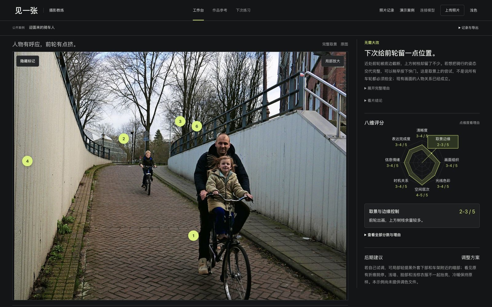
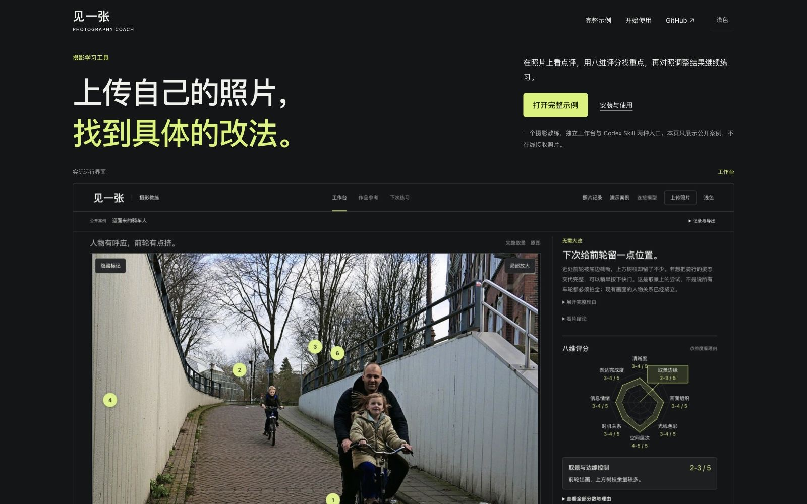
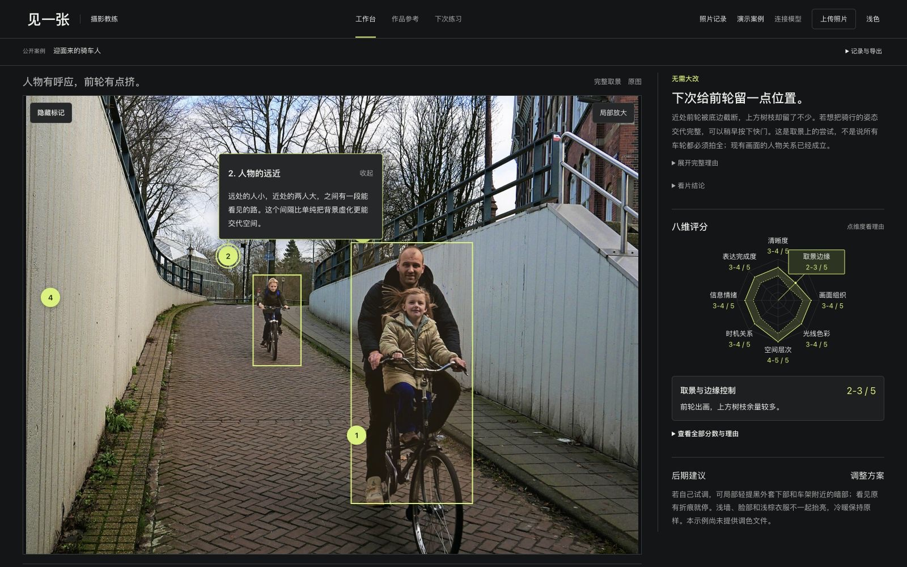

# Photography Coach · 摄影教练

**照片点评、调整对照与拍摄练习。**

Photography Coach 分析照片中的构图、光线、色彩和空间关系，给出八维评分、调整建议及拍摄练习。可以在独立工作台里上传照片，也可以在 Codex 中使用 Skill。两种方式共用摄影规则。

**装好 Skill 后，说「打开摄影教练」，就能启动同一项目的 Web 工作台；也可以继续在对话里点评照片。** 不需要再下载一份界面项目，也不需要 MCP。

这是**需要先下载到电脑的开源工具**，不是注册后直接使用的在线 AI 服务。日常主线是：上传自己的照片 → 查看具体点评和评分 → 对照试调、继续追问 → 按练习建议再拍。演示只是免密钥体验入口，不是必修课程。

[项目首页](https://judefluen-coder.github.io/photography-coach/) · [查看完整示例](https://judefluen-coder.github.io/photography-coach/demo-street/) · [开始使用](#开始使用) · [参与改进](CONTRIBUTING.md) · [English overview](#english-overview)

> 当前为实验版本。**Skill 和本机工作台已实现，工作台尚未使用真实 API 完成测试。** 实时参考作品检索、独立修图复核还未接入工作台，两种使用方式的功能暂不完全相同。评分只供练习参考，点评质量仍在验证中。

当前 `main` 提供 **2026-11-17 开发实验快照：Skill 可启动随附 Web 应用，界面统一使用「摄影教练 / Photography Coach」**。最近带标签的 Release 仍为 [v0.2.0-alpha.3 · MIT 授权与素材边界](https://github.com/judefluen-coder/photography-coach/releases/tag/v0.2.0-alpha.3)，该标签不包含新工作台；使用新界面请获取 `main`。启动方法和限制见[工作台说明](app/README.md)，历史内容见[版本地图](docs/versions.md)。

## 一个项目，两种入口

工作台和 Skill 都在这个仓库中维护，不需要分别下载两份项目。

```text
photography-coach/
├── SKILL.md                Codex Skill 入口（可用）
├── app/                    独立本机 Web 工作台（实验版）
├── core/                   共用规则装配、模型与图像处理基础
├── references/             当前摄影标准和知识索引
├── scripts/                工具与自动化测试
├── docs/demo-street/       当前主要公开报告示例
├── docs/demo/              历史后期对照示例
├── docs/archive/           早期界面源码归档
├── research/               历史规范、研究协议与资料索引
└── .local-data/            本机原始数据与历史报告，不进入 Git
```

独立界面使用看 [app/README.md](app/README.md)，Skill 使用看 `SKILL.md`；研究历史看 [research/](research/README.md)。旧六维规范和早期原型不覆盖当前八维点评要求。源码与版本只在一个 GitHub 仓库维护，私人照片和工作台记录保存在仓库外，不随项目分发。

## 界面预览

暗房工作台：桌面左侧看大图，右侧看主要建议、八维评分及对应理由；手机自动改为上下排列。下图为免密钥公开案例的实际运行截图，不是一次新模型点评。

[](app/README.md)

*不依赖 Codex，启动后即可看演示；真实点评需要自己的模型 API。[启动工作台](app/README.md)。照片保持完整取景，点标记展开点评；“局部放大”只改变浏览视图，不保存裁切。*

项目首页可切换工作台、图上点评和八维评分的真实截图；点击“完整示例”进入可操作的报告。README 图片本身不能操作。

想直接操作，可[打开街拍完整示例](https://judefluen-coder.github.io/photography-coach/demo-street/)；包含图上点评、八维区间与具体作品参考。[示例来源及限制](docs/demo-street/README.md)。它没有调色成品，因此不会显示前后对照或混合导出。这是静态报告，不提供在线上传或自动评图。

[](https://judefluen-coder.github.io/photography-coach/)

*2026-11-16 实际浏览器截图，非界面概念图。截图保留当时的临时名称；当前页面已统一为「摄影教练」。项目首页与静态示例随 `main` 更新；工作台仍需在本机启动，不是在线 AI 服务。*

当前截图摄影：Fons Heijnsbroek，[原图来源](https://commons.wikimedia.org/wiki/File:A_small_familie_is_biking_through_the_bicycle_tunnel,_in_the_city;_free_photo_Amsterdam_by_Fons_Heijnsbroek,_04-2022.jpg)，[CC BY-SA 4.0](https://creativecommons.org/licenses/by-sa/4.0/)。照片未裁切、未调色、未生成式重画，截图加入界面与点评；截图同以 CC BY-SA 4.0 提供，详见[图像说明](docs/images/README.md)。摄影师未背书此项目。

## 为什么做这个项目

看了很多摄影视频，轮到自己的照片，还是不知道哪里不对。

仅仅说“构图不错”或“主体不够突出”，并不能解释该怎么调整。这个项目希望让每条建议对应到具体的画面位置，说明判断理由、调整方法，以及可能损失的内容。

适合希望通过实际拍摄改进作品的摄影爱好者。提供一张照片即可；拍摄背景和想讨论的问题可以补充，但不必填写。

## 反馈长什么样

以下是表达方式的示意，不是某张照片的完整评测或效果证明：

> 保留左边的走道，只压一点人物旁边亮墙的亮度。
>
> 亮墙比脸更抢眼，走道则交代了人站在哪里。压暗墙面能让脸更容易被看见；墙仍然比衣服亮时就停。这样会少一点原来的明快感，但保住了环境。
>
> 下次在类似场景里，固定位置和取景，等人物转头，让脸与墙的明暗边界更清楚，再拍一张对照。

完整反馈还包括：

| 内容 | 说明 |
|---|---|
| 点评概要与主要问题 | 说明是否需要调整，以及优先考虑哪一处 |
| 画面分析与位置标注 | 检查人物、周围物体、边缘、线条、明暗、虚实和远近关系 |
| 八维评分与理由 | 每项给出评分区间和画面依据，不计算总分 |
| 重拍建议与后期方案 | 分别说明现场拍摄和当前文件可以怎么改，以及相应的取舍 |
| 一张具体作品参考 | 给出直达链接，说明看哪里、学什么、哪些地方不能照搬 |
| 拍摄练习 | 通常用 20-40 分钟练习一个问题，再比较新旧照片 |

风景、街拍、人像和静物的点评重点不同。分析会覆盖全画面，再优先解释影响较大的问题，不会只检查人物或构图。

## 开始使用

| 你想怎么用 | 需要准备 | 从哪里开始 |
|---|---|---|
| 只看产品示例 | 浏览器，不需要安装或密钥 | [在线静态示例](https://judefluen-coder.github.io/photography-coach/demo-street/)；不能上传新照片 |
| 在独立 Web 中上传照片 | Python 3.11+；真实点评另需自己的模型 API | 下载一次项目，然后使用入口 A |
| 让 Skill 打开 Web，或直接对话点评 | 同一份项目、支持图片的 Codex；打开 Web 另需 Python 3.11+ | 下载一次项目，然后使用入口 B |

### 先获取项目：只下载一份

首次使用，在终端运行：

```bash
git clone https://github.com/judefluen-coder/photography-coach.git photography-coach
cd photography-coach
```

没有 Git 时，可以在仓库页面选择 **Code → Download ZIP**，解压后进入包含 `SKILL.md` 的项目根目录。两种方式都获取 `main`，不要为 Web 和 Skill 分别下载两份。下面的启动与连接命令从这个根目录执行。

已经有此项目时，直接进入原目录，不要覆盖同名文件夹或重新克隆；更新前先检查并保留自己的改动。

### 入口 A：独立工作台，不需要 Codex

需要 Python 3.11+。在刚获取的项目根目录执行（macOS / Linux）：

```bash
python3 scripts/open_workbench.py --setup
```

启动器会打开浏览器；无法自动打开时，点击输出的本机地址。默认从 `8768–8788` 查找或启动；重复执行会复用同一项目、同一数据目录的服务，不关闭占用端口的其他程序。缺依赖时，`--setup` 仅在项目 `.venv` 中安装已声明依赖，不修改系统 Python。Windows 使用 `py -3 scripts/open_workbench.py --setup`。

点“演示案例”可直接体验已有报告，不需要密钥、不产生 API 费用；命令加 `--demo` 可直接进入演示。用自己的照片时，先在“连接模型”中填写支持图片和结构化输出的 Responses API 配置；选图、确认数据去向与费用后开始点评。可继续追问、在本机生成试调版、恢复记录并导出报告。

上传本身不会调用模型；密钥只保存在本机服务内存。此版本不提供公网托管，第三方端点与真实模型质量尚未验证。[完整启动说明、Windows 用法和限制](app/README.md)。

### 入口 B：在 Codex 中使用 Skill

#### 1. 把同一份项目连接为 Skill

Skill 入口需要能查看图片的 Codex 环境。已完成上面的下载后，macOS / Linux 在项目根目录执行：

```bash
mkdir -p ~/.codex/skills
ln -s "$PWD" ~/.codex/skills/photography-coach
```

已有同名目录时，不要覆盖或重复克隆；先确认原仓库的位置和本地改动。此前直接安装在 `~/.codex/skills/photography-coach` 的方式仍兼容，不要求所有使用者立即迁移。符号链接只是另一个入口，不占用第二份源码。安装后重新打开一个 Codex 任务。无需为另一种入口再克隆一份。

#### 2. 让 Skill 打开应用

安装后在 Codex 中发送：

```text
请用 $photography-coach 打开摄影教练。
```

Skill 会从自己的安装位置启动随附的 Web 应用，再打开实际可用的本机地址。不需要先发照片或填密钥，安装过程本身不会自动启动常驻服务。之后可在页面上传照片；想先体验，直接说「打开摄影教练的演示」。首次运行仍需要 Python 3.11+ 和安装依赖所需的权限／网络。没有本机命令执行能力的宿主只能提供启动命令，不能远程替你运行。

**Web 点评使用在页面配置的模型 API，不自动继承 Codex 订阅或额度，也不会从聊天记录读取密钥。** 启动页面和浏览演示不产生 API 费用，真实点评仍需在页面确认。

#### 3. 也可以直接附照片，在对话里点评

```text
请使用 $photography-coach 点评这张照片。
请分析整个画面并保留评分，说明哪些地方值得保留、最需要调整什么，以及重拍时可以怎么做。
请用通俗的话解释，并给出一张与建议相关的优秀作品参考。
```

标题、EXIF、拍摄经过、按快门的理由都不是必填项。只有截图或低清图片时，细节判断会受限，教练应明确说明。

#### 4. 生成调整图片与对照报告

```text
请直接做出调整后的图片，并生成可打开的视觉报告。
保留原图，单独给一个不裁切的仅调色版；如果裁切确实有帮助，再另给裁切＋调色版。
告诉我每一步改善了什么、牺牲了什么，不要改变照片里的人物和物体。
```

核验参考作品需要网络访问；生成调整图需要可用且获授权的图像处理工具。技能本身不附带模型或修图服务。条件不具备时，应提供建议并说明限制，不能用原图或生成式近似图冒充修好的成片。

### 在 Web 中的日常使用顺序

1. 打开工作台，上传自己的照片；想重点讨论什么可以选填，拍摄经过不是必填项。
2. 在「连接模型」中配置自己的 API；确认照片发送去向及费用后开始点评。关闭服务会清除内存中的密钥，下次启动需重新配置。
3. 先看主要建议，再点击照片上的标记看具体位置，查看八维评分和理由；也可以继续提问。
4. 模型返回有效参数时，点击生成本机试调版，比较真实的明暗／色彩与可选裁切结果，再决定是否下载。没有有效参数时只显示建议，不伪造调整成片。
5. 按练习建议再拍并上传。旧点评可从照片记录回看；**跨次照片自动比较、能力成长曲线尚未实现**，不把保存记录等同于证明进步。

想先体验可看演示，但不必先看课程或做题。GitHub Pages 是静态展示，不能直接点评新照片；`127.0.0.1` 是启动者自己电脑上的地址，也不是可分享给其他人的在线服务。

## 怎么看调整

调色和裁切解决的是不同问题，应该分开看。

| 版本 | 看什么 |
|---|---|
| 原图 | 留作判断依据，避免越修越忘记原来的关系 |
| 仅调色 | 保留原取景，只比较曝光、明暗层次和颜色 |
| 裁切＋调色 | 在同一调色基础上，判断收紧边缘是否值得失去那些环境 |

[](https://judefluen-coder.github.io/photography-coach/demo-street/)

*点图上的标记，展开或收起对应位置的分析；可按 Escape 关闭。只有提供真实同取景调色文件时，报告才显示“滑动对照”：左边原图，右边调色版。裁切版不参与此对照。*

有调色文件时，还可调节“影调强度”并下载当前混合结果；这不是新的模型调用，也不是局部曝光滑杆。实际处理的颜色／明暗与裁切文件可在[后期对照案例](https://judefluen-coder.github.io/photography-coach/demo/)中查看；该历史案例不再作为首页主视觉。

页面只展示实际提供的版本，不强制裁切。旧报告只有“原图 / 调整后”时也可以查看，但会说明没有独立调色对照。

你还可以：

- **在原图上看点评位置**，对照物体间距、线条和明暗关系；
- **用章节导航快速跳转**，按需看完整观察、八维评分、调整或参考；
- **显示或隐藏裁切框**，看清建议保留的范围；
- **下载当前版本的完整图片**，而非页面缩小预览；
- **复制练习说明**，和新照片一起发回 Codex，继续复盘。

报告是生成到本机的 `index.html` 和配套 `assets/`。保存或转移时请保留整个文件夹。仓库有[静态在线示例](https://judefluen-coder.github.io/photography-coach/demo/)，但不附带用户照片；**报告页本身不会接收上传、调用模型或自动修图。**

## 参考作品为什么值得看

参考作品应能帮助理解本次建议，而不只是题材、颜色相似，或者出自名家。

例如，点评提到暗色主体不清楚，参考就应展示背景如何衬托暗色主体；点评涉及多人关系，参考应能说明人物如何分组。每个参考都应说明：

1. **共同之处**：两张图的哪一处关系可以拿来比较。
2. **观察位置**：具体看哪里。
3. **不能照搬的地方**：场景、光线或表达目的有什么差别。
4. **练习方法**：如何在自己的拍摄中尝试。

本地收录了 150 张作品卡片，检索不限于这些作品。没有合适的本地参考时，Skill 可使用运行环境中的检索工具查找并核验其他来源。默认推荐一张；没有可靠匹配时会说明原因。受版权限制的作品只提供核验后的链接。**独立工作台暂未接入实时检索，会显示未检索状态。**

## 判断依据与边界

评价规则参考了有来源记录的摄影课程、馆藏资料、摄影师经验和技术文档。资料数量不能证明点评准确，模型仍可能看错物体、方向或人物关系。

- 暗、虚、倾斜、留白和遮挡不一定是问题。建议调整时，需要说明理由和可能的损失。
- 八维采用 0-5 的整数区间，每项给出理由；不生成总分，不对不同题材排名。
- 后期可调整裁切、曝光、颜色与局部明暗，不增删、替换或重排人物和物体。
- 无法从照片确认的身份、关系、地点和意图，应注明不确定。补充背景可帮助理解表达，但不能改变画面中实际可见的内容。

八个评分维度及具体规则见[评价标准](references/evaluation-standard.md)；完整输出要求见[点评格式](references/response-card.md)。

## 验证进展

**工程回归更新于 2026-11-17，界面截图为 2026-11-16；摄影评测仍为 2026-09-14 的证据。** 以下不是摄影准确率：

| 验证对象 | 当前证据 | 不能证明什么 |
|---|---|---|
| 代码与数据流程 | 223 项 Python 测试通过（新增 17 项启动检查及 1 项名称一致性检查）；报告与首页 JS、工作台语法、知识结构及 Skill 校验通过 | 真实 API 兼容、点评一定准确、修图一定好看 |
| 规则校准 | 24 张答案可见样本；其中 13 张复核 | 独立盲测通过率 |
| 新图查错 | 12 张冻结答卷，72 条分项引用证据 | 代表所有摄影场景或证明修订后水平 |
| 示例页面 | Chromium 桌面/手机宽度检查；版本、滑块键盘操作、定位、裁切框、复制失败路径通过 | 跨浏览器、全屏幕和所有报告均已验证 |

**正式发布质量门槛尚未通过。** 旧 v4 / v5 结果因图像身份或评分证据问题已作废，不能作为宣传指标；修订后的行为尚未在另一批独立新图上验证。JS 自动化检查使用 DOM 测试替身，本轮另做真实浏览器验收；二者不代替摄影质量验证。详细范围见[本轮验收记录](docs/visual-upgrade-verification.md)。

当前采用暗房工作台：深灰底与荧黄绿重点色，主画布承载完整照片、可开关标注和真实影调对照；桌面右侧集中呈现建议、区间评分和理由，不再预留空的调色栏。Skill 与独立工作台共用模板，不改摄影标准或历史评分。[布局修正](docs/layout-density-20261116.md) · [工程验收](docs/darkroom-verification-20261115.md) · [设计验收](design-qa.md)。

2026-11-17 增加 Skill 启动 Web 应用：已从本机已安装技能的符号链接、在非项目目录中启动，并确认重复打开复用同一进程、避让其他服务及真实页面可用。[启动验收与边界](docs/skill-web-launcher-20261117.md)。

本轮检查桌面及 390／320 像素窄屏、照片记录入口、标注边界、评分跳转、键盘对照与真实混合图片导出。前一轮的上传、刷新恢复和模拟服务流程见[工作台工程记录](docs/workbench-verification-20261109.md)；实际付费调用仍未测试。

进一步核对：[24 张校准](references/calibration-review-20260914.json) · [12 张查错](references/forward-review-20260914.json) · [阶段复核记录](references/gpt6-final-review-20260914.md) · [发布评测方法](references/benchmark-method.md)

阶段复核记录保留了当时的 148 项测试和待页面验收状态；后续三版本实现增加 8 项测试，使用者随后确认示例；alpha.1 增加 15 项空参考与底层模块测试，alpha.2 再增加 6 项目录、公开链接和私人数据边界检查。公开审查记录包含原句和哈希，但完整图片、答卷及运行包未全部公开，不是下载仓库即可完整复现的实验。

## 常见问题

**我不懂摄影，怎么判断它说得对不对？**

先看它能否指向具体位置，再做一次只改变一个变量的对照。你可以追问“如果不这样改，有什么好处？”或“这个建议可能破坏什么？”。解释听起来专业，不代表判断正确。

**这能代替摄影课程或专业老师吗？**

目前不能这样承诺。它适合围绕自己的照片持续练习；没有独立专家认证，也没有证据证明长期学习效果。

**照片是不是完全留在本地？**

生成的报告保存在本地，但使用 Codex、模型或外部工具处理照片时，数据处理范围取决于对应服务和权限。本项目不承诺全离线。不要在 Issue 或仓库中提交私人照片、敏感信息或未获授权的图片。

## 开发与参与

提交问题或修改代码前，请看[贡献指南](CONTRIBUTING.md)。调整规则、生成报告和运行测试的方法见[开发指南](docs/development.md)；修改界面文字请遵循[文案规范](docs/writing-style.md)。相关文件：

- [技能工作流](SKILL.md)
- [完整性六检](references/integrity-preflight.md)
- [参考作品匹配规则](references/reference-policy.md)
- [视觉报告字段与约束](references/visual-report.md)
- [知识库状态](references/knowledge-status.json)

项目还提供[可再生成的完整示例](docs/demo/README.md)、[版本记录](CHANGELOG.md)和[有来源的相邻产品对比](docs/alternatives.md)。GitHub Actions 会运行代码与结构检查；它的绿色状态不代表摄影点评已经通过独立盲测。

可在 [Issues](https://github.com/judefluen-coder/photography-coach/issues) 提交点评错误、参考图匹配问题、文案建议或页面故障。点评问题请附原话、对应画面位置，以及建议可能造成的损失。图片请只使用有明确公开授权的材料；修改评测时需保留原答卷与证据，不把已参与调参的样本继续称为独立盲测。

## 许可证

本项目原创的软件代码及随附使用文档采用 [MIT 许可证](LICENSE)。第三方摄影作品、其衍生图及包含照片的截图**不属于 MIT 授权范围**，各文件的来源、改动和适用许可见[第三方素材清单](THIRD_PARTY_NOTICES.md)。外部参考作品仅提供链接，不因本仓库的 MIT 许可证而改变权利归属。

## English overview

Photography Coach has **two entry points: a Codex Skill and an experimental standalone local web workbench**. After installing the Skill, ask `$photography-coach` to open the web app, or run `python3 scripts/open_workbench.py --setup` without Codex. The launcher opens a verified loopback URL and reuses a matching running instance. Try the labeled example without a key, or configure your own vision-capable Responses API for photo feedback, follow-up questions, local color/crop previews, history and portable reports. Opening the app does not inherit the host's subscription or make model calls. See the [setup and limitations](app/README.md).

First-time users need to download or clone the repository once, then choose either entry point; the Skill and Web app are bundled together. The main workflow is uploading your own photograph, reviewing feedback, trying edits, and photographing again. Automatic cross-session progress comparison is not yet implemented.

[Try the static demo](https://judefluen-coder.github.io/photography-coach/demo-street/) or install the Skill and attach a photo in Codex with `$photography-coach`. The GitHub Pages site remains a showcase, not a hosted AI service. The workbench is available on `main` as an experimental development snapshot, not in the older alpha.3 release; live API compatibility, reference retrieval and independent edit review remain unverified or unimplemented. Local storage does not mean offline AI processing. This is a research prototype, not an expert-certified evaluator. Project-authored software and accompanying usage documentation use the [MIT License](LICENSE); third-party images and derivatives are excluded and listed in the [asset notices](THIRD_PARTY_NOTICES.md).
