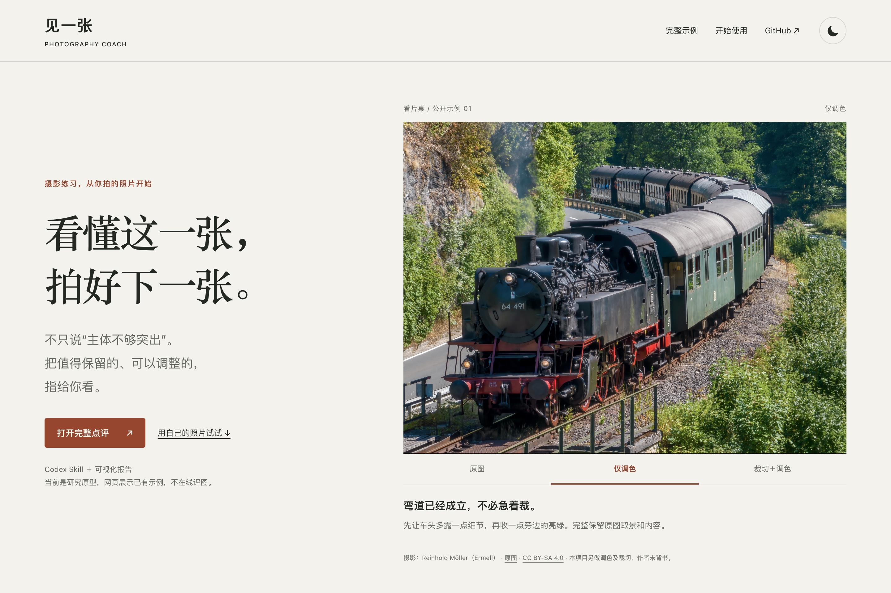
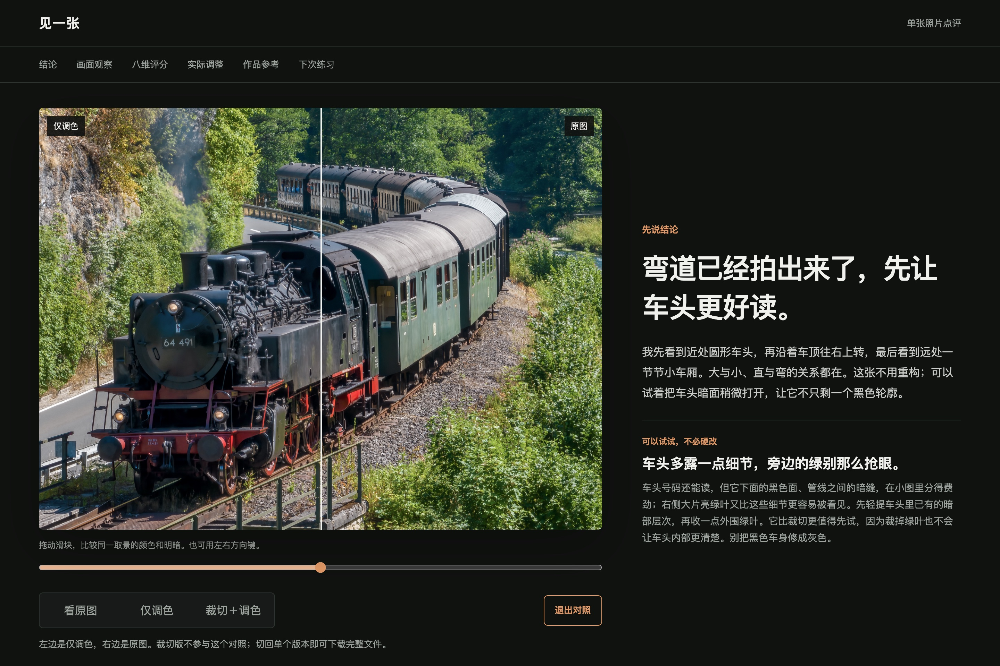

# Photography Coach · 摄影教练

**看懂这一张，拍好下一张。**

从你的一张照片出发，指出值得保留的地方、最值得调整的问题，给出重拍方法、调色对照和真正相关的优秀作品参考。项目提供两种使用入口的目标：在自己的 Codex 中调用 Skill，或在可视化工作台中直接上传照片、获得点评并继续讨论。

[可视化首页](https://judefluen-coder.github.io/photography-coach/) · [操作完整示例](https://judefluen-coder.github.io/photography-coach/demo/) · [开始使用](#开始使用) · [参与改进](CONTRIBUTING.md) · [English overview](#english-overview)

> 当前为研究原型。**已实现：Codex Skill、本地视觉报告和静态示例；尚未实现：可上传照片并真实评图的可视化工作台。** 双入口建设见[当前计划](docs/dual-entry-plan.md)，静态首页不是第二种使用方式，也不代表该目标已经完成。评分用于辅助练习，不是客观审美排名；摄影质量仍在验证中。

当前快照：[v0.2.0-alpha.3 · MIT 授权与素材边界](https://github.com/judefluen-coder/photography-coach/releases/tag/v0.2.0-alpha.3)。`core/` 和 `app/` 仍是未接通的开发基础，不是可运行的第二入口；详见[实现状态](app/README.md)。历史规范、旧原型和研究资料已经统一分类，见[版本地图](docs/versions.md)。

## 一个项目，两种入口

这里维护的是摄影教练整个项目，Skill 不是另一个项目，可视化界面也不另开版本仓库。

```text
photography-coach/
├── SKILL.md                Codex Skill 入口（可用）
├── app/                    独立可视化工作台（建设中）
├── core/                   共用规则装配、模型与图像处理基础
├── references/             当前摄影标准和知识索引
├── scripts/                工具与自动化测试
├── docs/demo/              当前完整公开示例
├── docs/archive/           早期界面源码归档
├── research/               历史规范、研究协议与资料索引
└── .local-data/            本机原始数据与历史报告，不进入 Git
```

当前使用看 `SKILL.md` 与 `docs/demo/`；开发新界面看 `app/`；研究历史看 [research/](research/README.md)。旧六维规范和早期原型不覆盖当前八维点评要求。源码与版本只在一个 GitHub 仓库维护，私人数据不随仓库分发。

## 界面预览

先在项目首页切换三种实际图片，了解教练怎么看片；再打开完整报告，看具体依据、评分和参考作品。

想直接操作，可[打开完整报告示例](https://judefluen-coder.github.io/photography-coach/demo/)；它包含原图、实际处理的仅调色版与裁切＋调色版，以及完整点评和下载文件。[示例来源及限制](docs/demo/README.md)。这是静态报告，不提供在线上传或自动评图。

[](https://judefluen-coder.github.io/photography-coach/)

*2026-10-19 实际浏览器截图，非界面概念图。README 里的图片不能操作；点击图片可进入可交互页面。*

示例摄影：Reinhold Möller（Ermell），[原图来源](https://commons.wikimedia.org/wiki/File:Behringersm%C3%BChle_Dampfeisenbahn-20220731-RM-111152.jpg)，[CC BY-SA 4.0](https://creativecommons.org/licenses/by-sa/4.0/)。截图中的图片沿用实际调色文件，未生成式重画。本页截图同以 CC BY-SA 4.0 提供，详见[图像说明](docs/images/README.md)；摄影师未背书此项目或调整。

## 为什么做这个项目

看了很多摄影视频，轮到自己的照片，还是不知道哪里不对。

“构图不错”“故事感不够”“主体再突出一点”都像点评，却很难变成下一次按快门时能做的事。Photography Coach 希望把这一步讲清楚：**在哪里、为什么、怎么改，以及改完会失去什么。**

它适合想通过自己的照片练习的摄影爱好者。你不需要先选出大师作品，不需要邀请专家，也不必先解释“我想表达什么”。从一张可查看的照片开始就可以。

## 反馈长什么样

以下是表达方式的示意，不是某张照片的完整评测或效果证明：

> 先别裁。人物旁边的亮墙更抢眼，但左边那条走道也交代了他站在哪里。
>
> 可以先只压一点墙面的亮度，让视线回到脸上。停在墙仍然比衣服亮的时候，不要把它压成灰色。这样会少一点原来的明快感，但不用牺牲环境。
>
> 下次在类似场景里，固定位置和取景，等人物转头，让脸与墙的明暗边界更清楚，再拍一张对照。

完整反馈还包括：

| 你会看到 | 帮你解决什么 |
|---|---|
| 第一判断与一个重点 | 先做哪件事；如果画面已经成立，也会明确说不必硬改 |
| 全画面看片地图 | 不只看人物，还看周围物体、边缘、线条、明暗、虚实、大小远近和关系 |
| 八维评分与理由 | 用分数区间定位短板，每项对应画面证据，不合成一个总分 |
| 重拍动作与后期方案 | 区分现场能解决的事和当前文件能调整的事，说明效果与代价 |
| 一张具体作品参考 | 给出直达链接，说明看哪里、学什么、哪些地方不能照搬 |
| 一次小练习 | 用 20–40 分钟只练一个变量，再带着新照片回来复盘 |

观察范围不限于一套固定清单。风景、街拍、人像、静物中的关键关系不同；教练先检查全画面，再选择最值得讲清楚的部分。**重点要突出，观察不能只剩一个点。**

## 开始使用

### 1. 获取项目并连接 Skill

Skill 入口需要能查看图片的 Codex 环境和 Git。macOS / Linux 推荐只克隆一份项目，再让 Codex 技能目录指向它：

```bash
git clone https://github.com/judefluen-coder/photography-coach.git ~/photography-coach
mkdir -p ~/.codex/skills
ln -s ~/photography-coach ~/.codex/skills/photography-coach
```

已有同名目录时，不要覆盖或重复克隆；先确认原仓库的位置和本地改动。此前直接安装在 `~/.codex/skills/photography-coach` 的方式仍兼容，不要求所有使用者立即迁移。符号链接只是另一个入口，不占用第二份源码。安装后重新打开一个 Codex 任务；工作台尚不可启动，不要把 clone 成功理解为 Web 入口已完成。

### 2. 附一张照片，发出请求

```text
请使用 $photography-coach 点评这张照片。
看完整个画面，保留评分，但把重点讲清楚：哪里已经成立，最值得改什么，下一次怎么拍。
请用通俗的话，并给一张真正相关的优秀作品参考。
```

标题、EXIF、拍摄经过、按快门的理由都不是必填项。只有截图或低清图片时，细节判断会受限，教练应明确说明。

### 3. 想看成片，就要求输出对照

```text
请直接做出调整后的图片，并生成可打开的视觉报告。
保留原图，单独给一个不裁切的仅调色版；如果裁切确实有帮助，再另给裁切＋调色版。
告诉我每一步改善了什么、牺牲了什么，不要改变照片里的人物和物体。
```

核验参考作品需要网络访问；生成调整图需要可用且获授权的图像处理工具。技能本身不附带模型或修图服务。条件不具备时，应提供建议并说明限制，不能用原图或生成式近似图冒充修好的成片。

## 怎么看调整

调色和裁切解决的是不同问题，应该分开看。

| 版本 | 看什么 |
|---|---|
| 原图 | 留作判断依据，避免越修越忘记原来的关系 |
| 仅调色 | 保留原取景，只比较曝光、明暗层次和颜色 |
| 裁切＋调色 | 在同一调色基础上，判断收紧边缘是否值得失去那些环境 |

[](https://judefluen-coder.github.io/photography-coach/demo/)

*点击报告中的“滑动对照”，拖动滑块或使用方向键，比较同一取景的颜色与明暗。左边仅调色，右边原图；裁切版不混进这个对照。调色轻提车头暗部、收敛外围亮绿，变化保持克制。*

页面只展示实际提供的版本，不强制裁切。旧报告只有“原图 / 调整后”时也可以查看，但会说明没有独立调色对照。

你还可以：

- **在原图上看点评位置**，对照物体间距、线条和明暗关系；
- **用章节导航快速跳转**，按需看完整观察、八维评分、调整或参考；
- **显示或隐藏裁切框**，看清建议保留的范围；
- **下载当前版本的完整图片**，而非页面缩小预览；
- **复制练习说明**，和新照片一起发回 Codex，继续复盘。

报告是生成到本机的 `index.html` 和配套 `assets/`。保存或转移时请保留整个文件夹。仓库有[静态在线示例](https://judefluen-coder.github.io/photography-coach/demo/)，但不附带用户照片；**报告页本身不会接收上传、调用模型或自动修图。**

## 参考作品为什么值得看

“也是街拍”“颜色很像”“出自大师”都不足以构成推荐理由。

教练先判断你的照片需要解决或保留什么，再找具体作品：例如背景怎样衬托暗色主体、多人之间怎样形成分组、边缘遮挡怎样保留空间。每个参考都应说明：

1. **共同之处**：两张图的哪一处关系可以拿来比较。
2. **观看任务**：花几十秒，具体看哪里。
3. **不能照搬的地方**：场景、光线或表达目的有什么差别。
4. **可迁移的练习**：下次如何试一次。

本地 150 张单图卡是检索起点，**不是推荐上限**。没有合适的本地作品时，可继续检索外部来源并核验。默认给一张；找不到可靠匹配就说明缺失，不用不相关的名作填空。受版权限制的作品只提供核验后的链接。

## 判断依据与边界

教练结合可追溯的摄影课程、博物馆与档案、摄影师经验、教育者内容及技术资料，按照片中的证据作判断。资料规模不等于权威性，模型也可能看错物体、方向或人物关系。

- **先保护，再调整。** 暗、虚、斜、留白和遮挡不自动等于错误；建议应说明实际损失和修复代价。
- **有分数，但不排名。** 八维采用 0–5 的整数区间，每项给理由；不生成总分，不拿不同题材排高低。
- **后期要忠实。** 允许摄影后期中的裁切、曝光、颜色与局部明暗等调整；不凭空增删、替换或重排人物和物体。
- **不知道就说不知道。** 不靠外貌或画面猜身份、关系、地点、拍摄意图和因果。补充背景可以改变表达判断，不能改写像素事实。

八个评分维度及具体规则见[评价标准](references/evaluation-standard.md)；完整输出要求见[点评格式](references/response-card.md)。

## 验证进展

**界面与工程检查更新于 2026-10-19；摄影评测仍为 2026-09-14 的证据。** 以下不是摄影准确率：

| 验证对象 | 当前证据 | 不能证明什么 |
|---|---|---|
| 代码与数据流程 | 177 项 Python 测试通过；报告与首页两组 JS 逻辑检查、知识结构校验通过；新底层模块只做离线测试 | 工作台已接通、点评一定准确、修图一定好看 |
| 规则校准 | 24 张答案可见样本；其中 13 张复核 | 独立盲测通过率 |
| 新图查错 | 12 张冻结答卷，72 条分项引用证据 | 代表所有摄影场景或证明修订后水平 |
| 示例页面 | Chromium 桌面/手机宽度检查；版本、滑块键盘操作、定位、裁切框、复制失败路径通过 | 跨浏览器、全屏幕和所有报告均已验证 |

**正式发布质量门槛尚未通过。** 旧 v4 / v5 结果因图像身份或评分证据问题已作废，不能作为宣传指标；修订后的行为尚未在另一批独立新图上验证。JS 自动化检查使用 DOM 测试替身，本轮另做真实浏览器验收；二者不代替摄影质量验证。详细范围见[本轮验收记录](docs/visual-upgrade-verification.md)。

进一步核对：[24 张校准](references/calibration-review-20260914.json) · [12 张查错](references/forward-review-20260914.json) · [阶段复核记录](references/gpt6-final-review-20260914.md) · [发布评测方法](references/benchmark-method.md)

阶段复核记录保留了当时的 148 项测试和待页面验收状态；后续三版本实现增加 8 项测试，使用者随后确认示例；alpha.1 增加 15 项空参考与底层模块测试，alpha.2 再增加 6 项目录、公开链接和私人数据边界检查。公开审查记录包含原句和哈希，但完整图片、答卷及运行包未全部公开，不是下载仓库即可完整复现的实验。

## 常见问题

**我不懂摄影，怎么判断它说得对不对？**

先看它能否指向具体位置，再做一次只改变一个变量的对照。你可以追问“如果不这样改，有什么好处？”或“这个建议可能破坏什么？”。解释听起来专业，不代表判断正确。

**这能代替摄影课程或专业老师吗？**

目前不能这样承诺。它适合围绕自己的照片持续练习；没有独立专家认证，也没有证据证明长期学习效果。

**照片是不是完全留在本地？**

生成的报告保存在本地，但使用 Codex、模型或外部工具处理照片时，数据处理范围取决于对应服务和权限。本项目不承诺全离线。不要在 Issue 或仓库中提交私人照片、敏感信息或未获授权的图片。

## 开发与参与

想参与，先看[贡献指南](CONTRIBUTING.md)：最有帮助的是一个能指到画面具体位置的错例。想调整规则、生成报告或运行验证，请看[开发指南](docs/development.md)。核心入口：

- [技能工作流](SKILL.md)
- [完整性六检](references/integrity-preflight.md)
- [参考作品匹配规则](references/reference-policy.md)
- [视觉报告字段与约束](references/visual-report.md)
- [知识库状态](references/knowledge-status.json)

项目还提供[可再生成的完整示例](docs/demo/README.md)、[版本记录](CHANGELOG.md)和[有来源的相邻产品对比](docs/alternatives.md)。GitHub Actions 会运行代码与结构检查；它的绿色状态不代表摄影点评已经通过独立盲测。

最有帮助的反馈是具体错例：**原话是什么、图中哪里与它矛盾、建议执行后会损失什么。** 欢迎在 [Issues](https://github.com/judefluen-coder/photography-coach/issues) 提交错误点评、参考图匹配问题、中文表达建议或可复现的页面问题。图片请只使用有明确公开授权的材料；修改评测时需保留原答卷与证据，不把已参与调参的样本继续称为独立盲测。

## 许可证

本项目原创的软件代码及随附使用文档采用 [MIT 许可证](LICENSE)。第三方摄影作品、其衍生图及包含照片的截图**不属于 MIT 授权范围**，各文件的来源、改动和适用许可见[第三方素材清单](THIRD_PARTY_NOTICES.md)。外部参考作品仅提供链接，不因本仓库的 MIT 许可证而改变权利归属。

## English overview

Photography Coach is a photo-coaching project with **two intended entry points: a Codex Skill and a visual workbench**. The Skill and portable reports exist today; the upload-to-critique workbench is not implemented yet. Start with your own photo: inspect image-specific observations, eight evidence-backed score ranges (no overall ranking), faithful color/crop comparisons, an exact relevant reference work, and one practical exercise. See the [current implementation plan](docs/dual-entry-plan.md).

[Try the static demo](https://judefluen-coder.github.io/photography-coach/demo/) or install the Skill using the command above and attach a photo in Codex with `$photography-coach`. The website does not accept uploads or run AI. Model access and editing tools are supplied by your environment; local reports do not mean all AI processing is offline. This is a research prototype, not an expert-certified evaluator. Project-authored software and accompanying usage documentation use the [MIT License](LICENSE); third-party images and derivatives are excluded and listed in the [asset notices](THIRD_PARTY_NOTICES.md).
