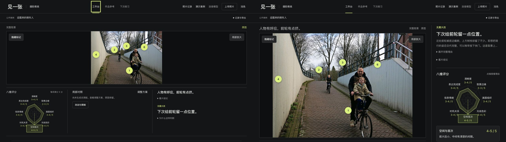

# 布局修正：大图与点评共享首屏 · 2026-11-16

使用者反馈“空白过多，有用信息被挤在很有限的地方”。本轮只修改布局、相关浏览交互和说明，不修改照片、点评结论、评分、模型接口或费用边界；没有提交、推送或部署。

## 本轮实际审查

1. **打开工作台默认公开案例：旧布局有问题。** 在 1280×720、完整取景时，画布宽 1216px，照片仅 360×270；约七成横向画布没有照片。评分图仅 210px，无调整文件的栏位仍占一整列。截图在下方并排图左侧。
2. **重排为左图／右点评：已修正。** 同视口完整照片约 707×530，画布约 842px；照片比例不变。右侧依次呈现主要建议、区间雷达、当前维度理由和后期内容。短屏理由预览两行，完整原文可展开。无调色文件不空占版本按钮或局部对照栏。
3. **选择评分与图上标记：已验证。** 点击取景维度显示 2-3 / 5 及原有理由，scrollY 保持 0；不再把整张嵌入式报告滚走。照片标记展开、关闭与同画布边界检查通过，全部八维理由仍可展开。
4. **宽屏与手机：已验证。** 1600×1000 使用大图和点评并排，390×844、320×740 纵排；检查根页面和报告没有横向溢出，完整照片不变形。短屏、手机不要求所有长文在一屏显示，按实际阅读顺序展开。

这两侧均为本轮浏览器实拍、1280×720、暗色、完整取景、相同照片、scrollY=0。合成只并排，不重绘界面；照片与截图许可见[图像说明](images/README.md)。不能把放大显示解释为修图或摄影质量提升。

## 实现与回归

- 共用模板改为桌面左图右侧信息区；评分图、理由及全部分数放在一起，移除迁移后留下的空章节。
- 画布按实际照片比例计算，并使用更合理的可用高度。默认保留整张；局部放大为明确的浏览状态，返回后恢复完整取景。
- 保留原有调色强度、真实文件下载、标注、完整分析、作品参考与练习，不引入付费调用。
- 回归测试增加评分不跳页、同区显示理由、无空评分章节、无空工具栏、无文件时展示真实建议的断言；两份公开示例从模板重新生成。
- 205 项 Python 测试通过；两份报告 JS、首页 JS、工作台语法、Skill 校验和生成一致性检查通过。DOM 逻辑检查和实际浏览器观察分开记录。

## 仍然存在的边界

报告内容长时仍需要滚动或展开。不同画幅可能有合理留边，不通过裁图填满窗口；手机标记可隐藏。完整八维理由展开后会加长信息区，这是用户主动阅读，不是默认空占位。

本轮没有真实模型测试、新摄影盲测、跨浏览器或物理设备认证。没有更改素材授权；私人照片不进入仓库。初始静态设计稿与工程测试通过均不等于使用者已经认可信息密度，应以本轮实际页面继续确认。
